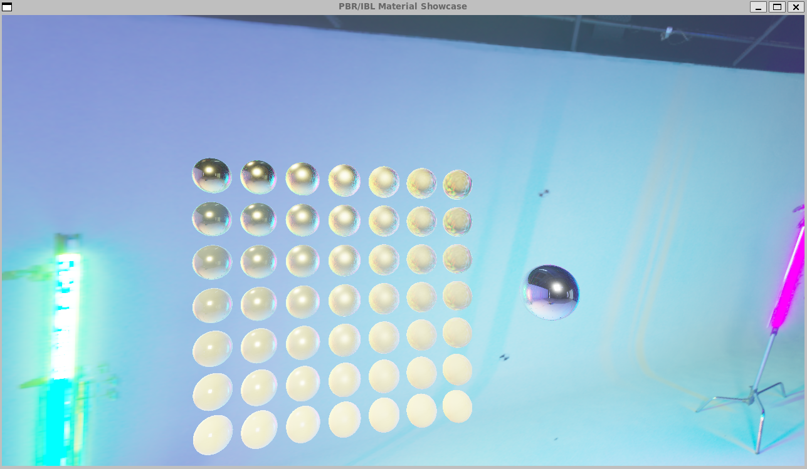
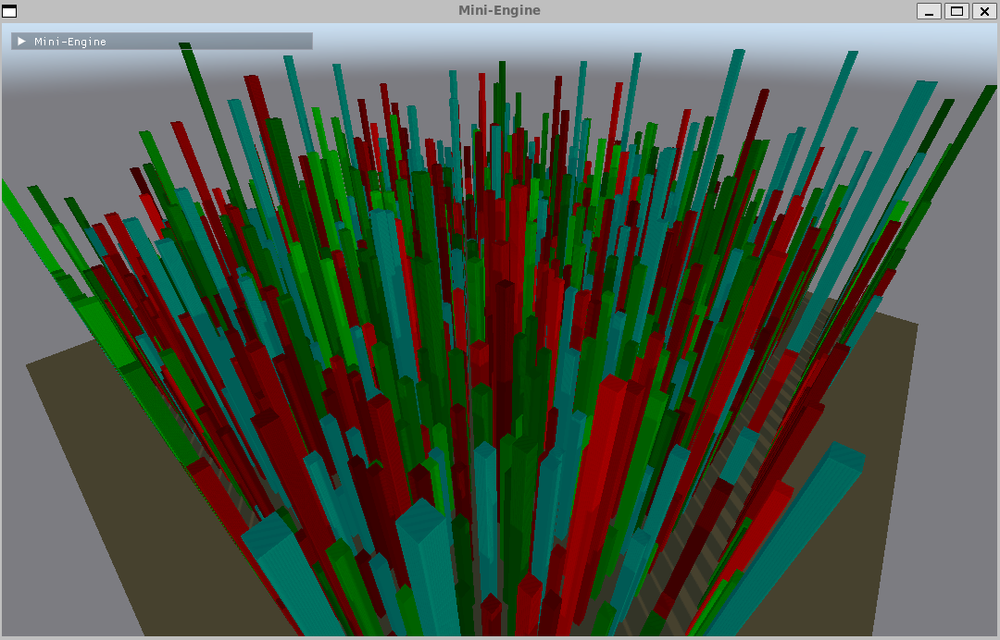

# Mini-Engine

> Learning rendering by implementing techniques and building them into an engine.


Mini-Engine began with Vulkan tutorial code and has grown into a C++20 rendering engine through a continuing cycle of **learning, implementation, integration, and measurement**.

The purpose of this project is to understand rendering techniques by implementing them, then making them work as part of an evolving engine. Each addition brings questions about resource ownership, pass dependencies, data layout, portability, and performance. The code and development notes document how those questions shaped the engine, including bugs, tradeoffs, and experiments that did not improve performance.

Today, the project includes Vulkan and WebGPU backends, a PBR scene showcase, and CT/MRI volume viewers. These applications put the accumulated rendering features to use and provide new problems to learn from.

[Build Guide](docs/guides/BUILD_GUIDE.md) · [Architecture](docs/ARCHITECTURE.md) · [Volume Viewer](docs/current/medical-volume/VIEWERS.md) · [Tests](tests/README.md) · [Documentation](docs/README.md)

*Detailed guides and development notes are primarily in Korean.*

<p align="center">
  
  
</p>

*Showcase screenshots from the engine's development. See the [viewer guide](docs/current/medical-volume/VIEWERS.md) for the current volume rendering applications.*

## Korean Summary

Vulkan 튜토리얼에서 출발해 다양한 렌더링 기법을 직접 구현하고, 이를 엔진의 기능으로 통합하며 발전시켜 온 학습 프로젝트입니다. **기법을 이해하고 구현한 뒤, 기존 기능과 함께 동작하도록 구조를 다듬고 검증하는 과정**에 의의를 둡니다. 현재는 Vulkan/WebGPU 공통 RHI 위에 PBR·GPU 기반 렌더링과 CT/MRI 볼륨 시각화까지 확장했으며, 그 과정의 설계 판단·디버깅·성능 측정을 기록하고 있습니다.

## From Tutorial to Engine

| Step | What I explored | How it became part of the engine |
| --- | --- | --- |
| Vulkan foundations | Devices, swapchains, buffers, textures, synchronization, and the render loop | Refactored the tutorial's single application into components with explicit resource ownership |
| Graphics abstraction | Separating rendering intent from API-specific operations | Introduced an RHI and implemented a WebGPU backend to exercise the same interfaces in the browser |
| Rendering techniques | PBR, IBL, shadows, deferred rendering, and post-processing | Integrated techniques into shared render passes, material handling, and resource management |
| Performance and integration | GPU culling, indirect drawing, profiling, glTF assets, and parallel command recording | Added engine facilities and measured their behavior in scenes with interacting features |
| Volume rendering | Ray marching, scattering, accumulation, denoising, and large-volume storage | Reused the rendering core in CT/MRI viewers, then extended it with brick streaming and progressive uploads |

The [architecture evolution record](docs/EVOLUTION.md) follows the earlier refactoring work. The [engine roadmap](docs/current/engine-roadmap/ENGINE_ROADMAP.md), [volume rendering notes](docs/current/medical-volume/README.md), and [debugging changelogs](docs/archive/changelogs/) continue that story.

## Current Features

| Area | Implementation | Code entry point |
| --- | --- | --- |
| Graphics abstraction | Device, buffer, texture, pipeline, and command encoder interfaces with Vulkan/WebGPU implementations | [RHI](src/rhi/) |
| Scene rendering | Deferred G-buffer, Cook–Torrance PBR, IBL, shadows, SSAO, Bloom, ACES, FXAA/TAA | [Renderer](src/rendering/Renderer.cpp) |
| GPU work management | Compute frustum culling, indirect draw, Render Graph, GPU timestamps | [Render Graph](src/rendering/graph/), [shaders](shaders/) |
| Asset pipeline | glTF 2.0/glb parsing, PBR materials and texture uploads | [AssetImporter](src/assets/AssetImporter.cpp) |
| Volume rendering | Ray marching, transfer functions, window/level, gradient shading, empty-space skipping | [VolumeRenderer](src/rendering/VolumeRenderer.cpp) |
| Volumetric scattering | Path tracing, progressive accumulation, A-trous denoising | [Volume shaders](shaders/volume_pathtrace.wgsl) |
| Large-volume storage | Brick atlas and page table, LRU/LOD streaming, native NIfTI mmap, progressive DICOM upload | [BrickedVolume](src/rendering/BrickedVolume.cpp), [loaders](src/assets/) |
| Browser viewer | DICOM file/folder selection, touch controls, memory/frame statistics, mobile defaults | [WASM viewer](tests/volume_viewer_wasm.cpp), [HTML UI](tests/volume_viewer_shell.html) |

The backends share upper-level rendering code, with differences in capabilities and implementation. Bindless textures and parallel shadow command recording are Vulkan-specific. See the [architecture guide](docs/ARCHITECTURE.md) for the backend comparison.

## Experiments and Lessons

Measurements help decide how a technique should fit into the engine. These examples are tied to the configurations in their original records; they are not universal performance guarantees or new measurements from this documentation update.

| Question | Approach | Recorded outcome |
| --- | --- | --- |
| Does parallel command recording help this scene? | Record shadow cascades on workers and measure CPU recording time | No recording-time benefit in the tested instanced scene: recording was not the bottleneck. [Record](docs/current/engine-roadmap/ENGINE_ROADMAP.md) |
| Can large NIfTI loads avoid full float/half intermediates? | Convert directly from an int16/uint16 mmap source during brick packing | Observed peak working set **6.57 → 2.30 GB** for a 1024³ synthetic volume on Windows 11 / RTX 4070, sampled every four seconds. [Record](docs/current/medical-volume/baselines/BASELINE_2026-06-10_DISK_PAGING_STEP5.md) |
| Can mobile DICOM loading reduce its memory peak? | Decode slices into a ring buffer and upload completed brick rows through staging slabs | A **512³ synthetic CT volume, equivalent to 256 MiB of dense 16-bit data**, loaded in the recorded iPhone Safari setup. Peak-memory reductions are estimates; device limits vary. [Record](docs/current/medical-volume/baselines/BASELINE_2026-07-22_Y1C_FULL.md) |
| How much storage does brick padding waste on thin volumes? | Adapt brick shape per axis and shrink the last brick | Atlas overhead was recorded at **approximately 6% or less** relative to dense storage across four public DICOM samples. [Record](docs/current/medical-volume/baselines/BASELINE_2026-07-09_LAST_BRICK_SHRINK.md) |

Public medical-data loading results are documented separately in the [real-data validation record](docs/current/medical-volume/baselines/BASELINE_2026-07-08_REAL_MRI.md). The notes also track unresolved LOD seams, missing bricks, and memory limits.

## Quick Start

### Run Tests Without a GPU

Requires CMake 3.28+ and a C++20 compiler. This configuration needs no Vulkan SDK, medical dataset, or external test framework.

```sh
cmake -S tests -B build-tests -DCMAKE_BUILD_TYPE=Release
cmake --build build-tests --config Release
ctest --test-dir build-tests -C Release --output-on-failure
```

This runs the thread pool and NIfTI/raw loader tests. See the [testing guide](tests/README.md) for DICOM regression tests and manual rendering checks.

### Windows / Vulkan

Requires CMake 3.28+, Ninja, a compiler with C++20 module support, the Vulkan SDK (including `vulkan.cppm` and `glslc`), Python 3, and vcpkg. The local development setup uses Clang 21 with the Visual Studio 2022 toolchain.

Set `VCPKG_ROOT` to your vcpkg installation and use a developer terminal with the compiler and SDK configured. The first configure downloads and builds the vcpkg dependencies.

```powershell
cmake -S . -B build-native -G Ninja -DCMAKE_BUILD_TYPE=Release -DCMAKE_CXX_COMPILER=clang++ -DCMAKE_TOOLCHAIN_FILE="$env:VCPKG_ROOT/scripts/buildsystems/vcpkg.cmake"
cmake --build build-native --target MiniEngine volume_viewer
.\build-native\MiniEngine.exe
.\build-native\volume_viewer.exe
```

The viewer starts with a procedural volume when no input is supplied. To generate and open a small synthetic CT volume:

```powershell
python scripts/make_synthetic_nii.py build-native/synthetic_ct.nii 96 96 48
.\build-native\volume_viewer.exe build-native/synthetic_ct.nii
```

### WebGPU / WebAssembly

The Windows script uses Emscripten at `$env:USERPROFILE\emsdk` by default. SDK setup and Linux/macOS commands are in the [build guide](docs/guides/BUILD_GUIDE.md).

```powershell
.\scripts\wasm.ps1 build -Target MiniEngine
.\scripts\wasm.ps1 serve -Target volume_viewer_wasm
```

Open `http://localhost:8000/volume_viewer_wasm.html` for the volume viewer or `/MiniEngine.html` for the scene showcase. A browser and GPU with WebGPU support are required; use HTTPS when accessing from another device. The initial WASM build downloads dependencies and public DICOM samples.

## Project Structure

```text
src/
  assets/       glTF, NIfTI, DICOM, and raw loaders
  rendering/    Scene/volume renderers, brick storage, Render Graph
  rhi/          Shared interfaces + Vulkan and WebGPU backends
  scene/        Cameras, meshes, scene management
  resources/    Texture and resource management
  ui/           Native ImGui integration
  utils/        Thread pool, file mapping, profiling
  wasm/         JavaScript bindings for the showcase
shaders/        GLSL / WGSL sources
tests/          Regression tests, interactive demos/viewers, HTML shells
scripts/        Build, serving, and synthetic-data tools
docs/           Architecture, guides, decisions, measurements, development notes
```

## Scope and Ongoing Work

- This is an ongoing learning and rendering research project. Its medical viewers are experimental and have not been validated for clinical diagnosis or as a complete DICOM/PACS implementation.
- DICOM support focuses on single-series, 16-bit grayscale CT/MR. JPEG-LS, big-endian data, and general patient-coordinate reconstruction remain outside the supported scope. NIfTI supports little-endian, single-file `.nii`; `.nii.gz` is not read directly.
- Progressive DICOM upload currently uses the **Static atlas path**. Streaming/LOD uses a separate path and can exhibit missing bricks or seams.
- Further work includes measurements on iPad and integrated GPUs, mobile memory policies, and large-volume paging in the browser. See [current work and roadmaps](docs/current/README.md).

## Dependencies and Assets

The project uses GLFW, GLM, Vulkan Memory Allocator, Dear ImGui, cgltf, stb, tinyobjloader, OpenJPEG, and libjpeg-turbo. Native dependencies are listed in [vcpkg.json](vcpkg.json); WASM dependencies are configured in [CMakeLists.txt](CMakeLists.txt).

A project-wide distribution license has not yet been added. Sources and attribution status for external libraries, models, environment maps, and sample data are documented in [Dependencies and Assets](docs/ASSETS.md).
